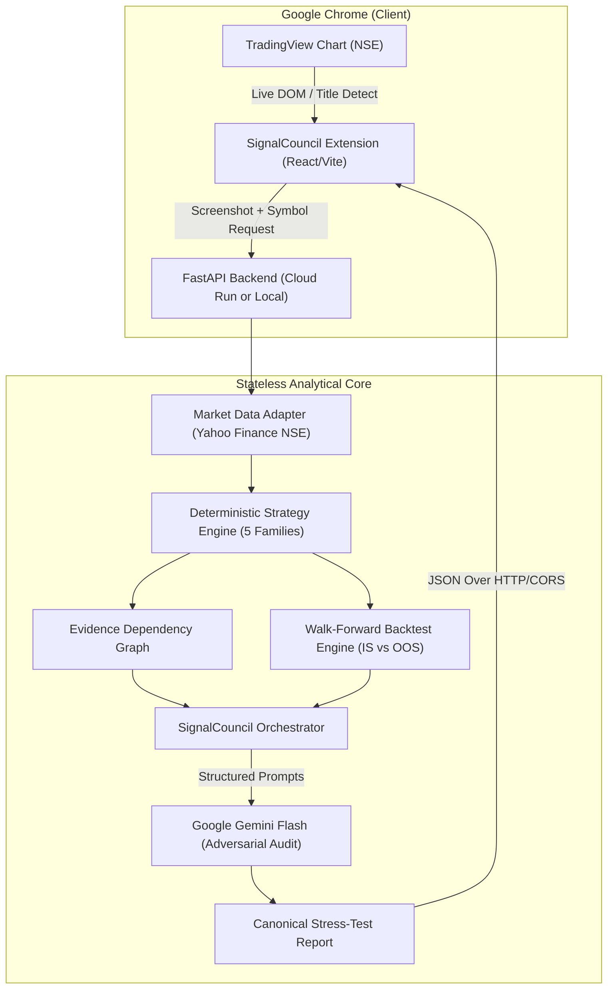

# SignalCouncil — Trade Thesis Stress Tester

> **AI-Powered Multi-Strategy Financial Decision Intelligence for Indian Equities**  
> *Only Indian NSE market stocks are supported for now.*

[](https://www.python.org/)
[](https://fastapi.tiangolo.com/)
[](https://react.dev/)
[](https://www.typescriptlang.org/)
[](https://ai.google.dev/)
[](https://developer.chrome.com/docs/extensions/mv3/)

---

> [!IMPORTANT]
> **Market Coverage Disclaimer: Indian NSE Equities Only**  
> SignalCouncil is specifically calibrated and tested for **Indian National Stock Exchange (NSE)** stocks and benchmark indices (e.g., `RELIANCE`, `TCS`, `INFY`, `HDFCBANK`, `TATAMOTORS`, `NIFTY 50`, `BANKNIFTY`).  
> **Foreign / US stocks (such as `AAPL`, `TSLA`, `MSFT`) are NOT traded on the NSE and will return an `Invalid symbol` error.**

---

## Table of Contents

- [Overview](#overview)
- [System Architecture](#system-architecture)
- [Prerequisites](#prerequisites)
- [Step-by-Step Installation Guide](#step-by-step-installation-guide)
  - [1. Clone the Repository](#1-clone-the-repository)
  - [2. Backend Setup (FastAPI & Python)](#2-backend-setup-fastapi--python)
  - [3. Frontend Setup (Chrome Extension & Vite)](#3-frontend-setup-chrome-extension--vite)
  - [4. Load Extension into Google Chrome](#4-load-extension-into-google-chrome)
  - [5. Connect Extension to Backend API](#5-connect-extension-to-backend-api)
- [Usage Guide: How to Stress-Test a Trade](#usage-guide-how-to-stress-test-a-trade)
- [Troubleshooting & Common Questions](#troubleshooting--common-questions)
- [Production Deployment (Google Cloud Run)](#production-deployment-google-cloud-run)
- [Running Automated Tests](#running-automated-tests)
- [Core Principles & Non-Goals](#core-principles--non-goals)

---

## Overview

SignalCouncil is an AI-assisted swing-trading decision-support tool. Rather than generating simplistic buy/sell signals, SignalCouncil acts as an **Adversarial Investment Committee**:
1. **Deterministic Multi-Strategy Engine**: Computes classical quantitative strategies (Trend Following, Momentum, Mean Reversion, Breakout, Price Action) across multiple timeframes.
2. **Evidence Dependency Matrix**: Measures statistical correlation across indicators to eliminate artificial consensus (e.g., flagging when RSI, Stochastics, and MACD merely repeat the same momentum claim).
3. **Walk-Forward Historical Validation**: Separates historical analogues into In-Sample (IS) and Out-of-Sample (OOS) data to audit against selection bias and overfitting.
4. **Adversarial Synthesis via Gemini**: A Devil's Advocate agent aggressively audits the thesis for failure modes, downside risk, and false confidence before granting a confirmation verdict.

---

## System Architecture



- **`extension/`**: Chrome Extension Side Panel built with React 19, TypeScript, and Vite.
- **`backend/`**: High-performance stateless API built with Python 3.12, FastAPI, and Pydantic v2.
- **`infra/`**: Docker container configurations and Cloud Run deployment manifests.

---

## Prerequisites

Before beginning installation, ensure you have the following installed on your machine:

| Requirement | Minimum Version | Purpose |
| :--- | :---: | :--- |
| **Python** | `3.11+` (3.12 recommended) | Backend API server and quantitative math engine |
| **Node.js** | `18.0+` (20+ recommended) | Extension build tooling |
| **npm** | `9.0+` | Node package manager |
| **Google Chrome** | Latest stable | Host browser for the Manifest V3 side panel extension |
| **Gemini API Key** | — | Required for AI consensus synthesis ([Get a free key here](https://aistudio.google.com/)) |

---

## Step-by-Step Installation Guide

### 1. Clone the Repository

Open your terminal and clone the repository:

```bash
git clone https://github.com/0xajay/SignalCounsil.git
cd signal-council
```

---

### 2. Backend Setup (FastAPI & Python)

The backend runs as a FastAPI service that computes strategy indicators, dependency graphs, and calls Gemini for adversarial synthesis.

#### Step 2.1: Navigate to the `backend/` directory
```bash
cd backend
```

#### Step 2.2: Create a Python virtual environment
Using standard Python `venv`:
```bash
python3 -m venv .venv
source .venv/bin/activate
```
*(On Windows: `.venv\Scripts\activate`)*

> [!TIP]
> If you have [`uv`](https://github.com/astral-sh/uv) installed, you can create and sync faster:
> ```bash
> uv venv
> source .venv/bin/activate
> uv pip install -r requirements.txt
> ```

#### Step 2.3: Install backend dependencies
```bash
pip install -r requirements.txt
```

#### Step 2.4: Set your Gemini API Key
Create a `.env` file in the `backend/` directory or export the variable directly in your shell:

```bash
# Option A: Create a .env file inside backend/
echo "GEMINI_API_KEY=your_actual_gemini_api_key_here" > .env

# Option B: Shell export
export GEMINI_API_KEY="your_actual_gemini_api_key_here"
```

#### Step 2.5: Start the backend server
```bash
uvicorn main:app --reload --host 0.0.0.0 --port 8080
```

You should see output confirming the server is listening:
```text
INFO:     Started server process [12345]
INFO:     Waiting for application startup.
INFO:     Application startup complete.
INFO:     Uvicorn running on http://0.0.0.0:8080 (Press CTRL+C to quit)
```

#### Step 2.6: Verify backend health
In a separate terminal tab, run:
```bash
curl http://localhost:8080/health
```
Expected JSON response:
```json
{"status":"healthy","service":"signal-council-api","version":"1.0.0","environment":"production"}
```

---

### 3. Frontend Setup (Chrome Extension & Vite)

The frontend is a Chrome Extension that runs in the browser side panel beside your charts.

#### Step 3.1: Open a new terminal tab and navigate to `extension/`
```bash
cd signal-council/extension
```

#### Step 3.2: Install Node dependencies
```bash
npm install
```

#### Step 3.3: Build the unpacked extension
```bash
npm run build
```

This compiles TypeScript and packages the extension into the **`extension/dist/`** directory.

```text
✓ built in ~400ms
dist/manifest.json
dist/index.html
dist/assets/...
```

---

### 4. Load Extension into Google Chrome

1. Open Google Chrome and type `chrome://extensions/` into the URL address bar.
2. In the top-right corner of the Extensions page, switch the **Developer mode** toggle to **ON**.
3. In the top-left corner, click the **Load unpacked** button.
4. In the file picker dialog, navigate to your cloned repository and select the **`extension/dist/`** directory.
5. SignalCouncil will now appear in your extensions list.
6. Click Chrome's **Extensions puzzle icon** (top right of browser window) and click the **Pin** icon next to **SignalCouncil** for quick access.

---

### 5. Connect Extension to Backend API

By default, the extension connects to your local backend (`http://localhost:8080`) or a deployed Cloud Run instance:

1. Click the **SignalCouncil** extension icon in Chrome's toolbar to open the side panel.
2. At the top of the extension, click the **API Server** badge (or gear icon).
3. Configure your API base URL:
   - **For local development**: `http://localhost:8080`
   - **For production Cloud Run**: `https://<YOUR-CLOUD-RUN-SERVICE-URL>`
4. Click **Test Connection**. A green checkmark will confirm that the extension successfully reached the `/health` endpoint.
5. Click **Save**. The configuration is saved locally in `chrome.storage.sync`.

---

## Usage Guide: How to Stress-Test a Trade

### Supported Market Instruments (NSE Only)
SignalCouncil currently supports **Indian NSE market stocks and indices**. Supported ticker formats:
- **Equities**: `RELIANCE`, `TCS`, `INFY`, `HDFCBANK`, `ICICIBANK`, `TATAMOTORS`, `SBIN`, `ITC`, `BHARTIARTL`, `LT`, etc.
- **Indices**: `NIFTY`, `NIFTY50`, `BANKNIFTY`.

---

### Option A: Automatic Chart Detection via TradingView (Recommended)
1. In Google Chrome, open any Indian stock chart on TradingView:
   - Example: [TradingView — NSE:RELIANCE](https://in.tradingview.com/chart/?symbol=NSE:RELIANCE) or `NSE:TCS`
2. Open the **SignalCouncil** side panel.
3. SignalCouncil will automatically detect the active instrument and timeframe (e.g., `TradingView Chart Linked: RELIANCE · 1D`).
4. Click **Run Adversarial Stress Test**.
5. The extension captures the live chart screenshot, pulls OHLCV history, runs the multi-agent council, and renders the Trader View report.

### Option B: Manual Symbol Entry
1. Open the **SignalCouncil** side panel.
2. Type an Indian NSE ticker symbol into the input field (e.g. `RELIANCE` or `INFY`).
3. Select your timeframe:
   - `15m` (Intraday)
   - `1h` (Tactical)
   - `1d` (Daily / Swing — Recommended)
   - `1wk` (Macro)
4. Click **Run Adversarial Stress Test**.

---

### Interpreting the 5-Tier Trader View

Once analysis completes, review the interactive report:

| Section | What It Audits |
| :--- | :--- |
| **Verdict Banner** | Overall consensus: `CONFIRMED_SETUP`, `FRAGILE_EDGE`, `OVERFIT_WARNING`, or `NO_EDGE`. |
| **Trade Geometry** | Key price levels: Entry Zone, Invalidation Stop-Loss, and Target Levels (1.5R / 2.0R). |
| **Evidence Ledger** | Granular ledger separating claims into **Supporting**, **Opposing (Devil's Advocate)**, and **Neutral**. |
| **Dependency Graph** | Interactive network mapping raw price data → indicators → strategy signals → evidence families. Red edges highlight dangerous multi-collinearity or redundant confirmation. |
| **Historical Setup Validation** | Compares current market conditions against similar historical analogues, splitting metrics between **In-Sample** and **Out-of-Sample** walk-forward windows. |
| **Safety Gating & Diagnostics** | Audits data quality, ATR volatility expansion, and maximum historical drawdown. |

---

## Troubleshooting & Common Questions

### Q: Why do I get `Invalid symbol: AAPL for market NSE`?
**A:** SignalCouncil is intentionally calibrated for the **Indian NSE market**. Apple Inc. (`AAPL`) is a US stock traded on NASDAQ, not the NSE. To test the system, please use any Indian equity ticker such as `RELIANCE`, `TCS`, `INFY`, or `NIFTY`.

### Q: Why does the extension show `Cannot reach API at http://localhost:8080`?
**A:** 
1. Ensure the Python backend is running: `uvicorn main:app --reload --port 8080`.
2. Verify local connectivity by opening `http://localhost:8080/health` in your browser.
3. Click the **API Server** badge in the extension header to ensure the URL is set to `http://localhost:8080` (without trailing slash).

### Q: Do I need a paid Gemini API key?
**A:** **No.** SignalCouncil works seamlessly with the free tier of Google Gemini API (`gemini-2.5-flash`) available via [Google AI Studio](https://aistudio.google.com/).

### Q: How do I rebuild the extension after pulling code changes?
```bash
cd extension
npm run build
```
Then navigate to `chrome://extensions/` in Chrome and click the **Reload (↻)** button on the SignalCouncil card.

---

## Production Deployment (Google Cloud Run)

The backend is fully containerized and designed for serverless execution on **Google Cloud Run**:
- Completely stateless (zero local database files; auto-scales 0 to N instances).
- Dynamic port binding via `$PORT`.
- Gemini API key managed securely via **Google Secret Manager**.

To deploy to Cloud Run:
```bash
cd backend

# 1. Store API Key in Secret Manager
gcloud secrets create signal-gemini-key --replication-policy="automatic"
echo -n "YOUR_GEMINI_API_KEY" | gcloud secrets versions add signal-gemini-key --data-file=-

# 2. Deploy Service
gcloud run deploy signal-council-api \
  --source . \
  --region us-central1 \
  --allow-unauthenticated \
  --set-secrets GEMINI_API_KEY=signal-gemini-key:latest \
  --set-env-vars ENVIRONMENT=production,CORS_ORIGINS="*" \
  --memory 1Gi \
  --cpu 1
```

For complete deployment details and CI/CD instructions, see **[DEPLOYMENT.md](DEPLOYMENT.md)**.

---

## Running Automated Tests

### Backend Tests (Pytest)
Run the quantitative integrity and multi-agent test suite:

```bash
cd backend
source .venv/bin/activate
PYTHONPATH=. pytest tests/ -v
```

Key test suites included:
- `test_strategy_engine.py`: Classical indicator calculation and deterministic signal generation.
- `test_context_consistency.py`: Strict isolation between raw market data and AI synthesis.
- `test_false_consensus.py`: Validation that collinear indicators are penalized by the council.
- `test_health_and_config.py`: Health check probes and Secret Manager handling.

### Frontend Tests
```bash
cd extension
npm test
```

---

## Core Principles & Non-Goals

- **Decision Support, Not Execution**: SignalCouncil provides analytical stress-testing and decision intelligence. It **does not execute trades** and does not integrate with broker order APIs.
- **No Centralized User Authentication**: The application operates statelessly; user settings (such as custom API URLs) are saved privately inside Chrome's local storage (`chrome.storage.sync`).
- **Deterministic Math First**: Indicator calculations, risk parameters, and backtests are executed mathematically using strict formulas — LLMs are never used to "hallucinate" math or historical prices.
- **Adversarial Rigor**: The AI agents are explicitly prompted to challenge assumptions and expose hidden risks rather than confirm existing biases.

---

## License

This project was built for the Google AI Builder Cup Hackathon. All rights reserved.
